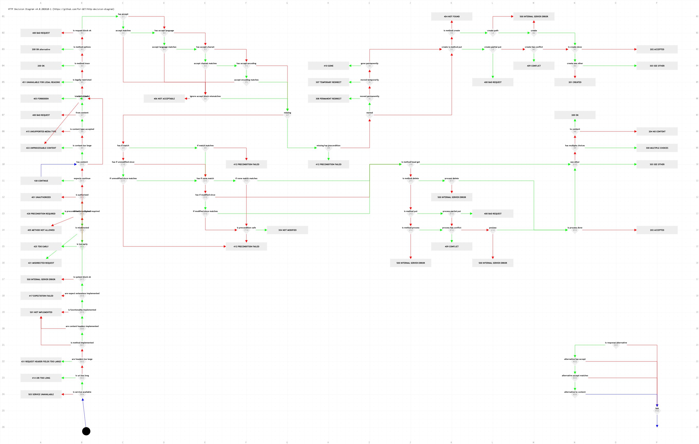

# http-decision-diagram

An activity diagram to describe the resolution of HTTP response status codes, given various headers, implemented via semantical callbacks.

And it goes on Twitter as [#httpdd](https://twitter.com/search/realtime?q=httpdd) - HTTP Decision Diagram.

The diagram follows the indications in [RFC9110](https://datatracker.ietf.org/doc/html/rfc9110) [RFC9111](https://datatracker.ietf.org/doc/html/rfc9111) [RFC9112](https://datatracker.ietf.org/doc/html/rfc9112), and fills in the void where necessary (see also [RFC6585](https://datatracker.ietf.org/doc/html/rfc6585) [RFC7725](https://datatracker.ietf.org/doc/html/rfc7725) [RFC8470](https://datatracker.ietf.org/doc/html/rfc8470) [RFC9211](https://datatracker.ietf.org/doc/html/rfc9211) [RFC9213](https://datatracker.ietf.org/doc/html/rfc9213)). Under no circumstances does this diagram override the HTTP specifications. If it does, please file an issue as soon as possible.

Out of scope (and why): [RFC2774](https://datatracker.ietf.org/doc/html/rfc2774) HTTP Extension Framework's 510 (Not Extended) — the entire ANCM document is now [Historic](https://datatracker.ietf.org/doc/status-changes/), so no server behavior is expected for 510; likewise 207/208/508 (WebDAV, RFC 4918/5842) and 226 (IM Used, RFC 3229) with their DAV/IM-specific semantics.

## Diagram

* [PNG](../httpdd.fsm.png) (export of the FSM rendered by [JointJS](https://jointjs.com/))
* [SVG](https://jointjs.com/) equivalent available at `httpdd.fsm.html`

## FSM

* [JSON](../httpdd.fsm.json) (export)
* [Cosmogol](../httpdd.fsm.cosmogol) (source)
    * Internet Draft - [Cosmogol: a language to describe finite state machines](http://tools.ietf.org/html/draft-bortzmeyer-language-state-machines-01)
    * The JSON is generated from the Cosmogol source: `node tools/cosmogol.js httpdd.fsm.cosmogol httpdd.fsm.json`

## Overview

The decision diagram is split into standalone color-coded blocks

1. [System](README_system.md) (white)
1. [Request](README_request.md) (blue)
1. [Accept](README_accept.md) (green)
1. [Retrieve](README_retrieve.md) (white)
1. [Precondition](README_precondition.md) (yellow)
1. Create/Process
    * [Create](README_create.md) (violet)
    * [Process](README_process.md) (red)
1. [Response](README_response.md) (cyan)
1. [Alternative](README_alternative.md) (gray)

---

## Callback Types

**NOTE** All variables referenced below may have specific variances from the under_score notation - camelCase, PascalCase, etc. - when implemented.

The decision diagram makes use of different types of callbacks to get request or resource specific information. Regardless of the type though, each callback MUST

* have read-write access to 2 variables: `Transaction` and `Context`
* refrain from doing more/less than what the decision block states
* have pertinent *defaults*

### Transaction structure

`Transaction` MUST be a key-value structure, initialized when receiving the request, with the following keys:

* `request` =
  * `version` = HTTP version e.g. '1.1'
  * `method` = Uppercase HTTP method
  * `scheme` = Lowercase scheme e.g. 'http'
  * `host` =
    * `source` = Original host e.g. 'example.com:8080'
    * `hostname` = Lowercase hostname e.g. 'example.com'
    * `port` = e.g. '8080'
  * `target` = Key-value of request URI parts
      * `path` = e.g. '/p/a/t/h'
      * `query` = e.g. '?query=string'
  * `headers` = Key-value of lowercase header names and their values
      * `accept` =
      * `accept-language` =
      * `accept-charset` =
      * `accept-encoding` =
      * `content-type` =
      * `content-length` =
  * `representation` =
  * `h` = Key-value of lowercase header names and their data structures/classes/modules/helpers
      * `accept` = *AcceptHeader*
      * `content-encoding` = *ContentEncodingHeader*
      * `content-type` = *ContentTypeHeader*
      * `content-language` = *ContentLanguageHeader*
      * `expect` = *ExpectHeader*
      * `if-match` = *IfMatchHeader*
      * `if-modified-since` = *IfUnmodifiedSinceHeader*
      * `if-none-match` = *IfNoneMatchHeader*
      * `if-unmodified-since` = *IfModifiedSinceHeader*
* `response` =
    * `status` =
    * `headers` =
    * `representation` =
    * `h` =
        * `allow` = *AllowHeader*
        * `content-encoding` = *ContentEncodingHeader*
        * `content-type` = *ContentTypeHeader*
        * `content-language` = *ContentLanguageHeader*
        * `content-location` = *ContentLocationHeader*
    * `content` = Key-value pairs of content headers and their chosen values (initially during the accept phase, and optionally modified afterwards)
        * `type` =
        * `language` =
        * `charset` =
        * `encoding` =
* `error` =
  * `described-by` =
  * `support-id` =
  * `title` =
  * `detail` =
* `log` =
    * `transitions` = *Array*
        * `from` =
        * `to` =
    * `callbacks` = *Array*
        * `state` =
        * `callback` =
        * `result` =

### Context structure

*Context* MUST be whatever the resource developer desires. It MUST be irrelevant to the decision flow. For the sake of clarity though, in this documentation you may find these references:

* `request` =
  * `entity` =
* `response` =
  * `entity` =
* `error` =
  * `entity` =

### Built-in callbacks `: in`
Some callbacks MUST be built-in by the system, and thus they are not explicitly marked on the diagram. They are not specific to the resource or the request and they are an implementation of HTTP-specific logic.

### Resource decision callbacks `:bin`
Resource logic is coded in these callbacks as an answer to binary questions - TRUE or FALSE. These callbacks have the power to end the decision flow early.

### Resource variable callbacks `:var`
Resource logic is coded in these callbacks as variable values. Each callback defines the type that it handles, and returning an unexpected type or value will yield _500 Internal Server Error_. These callbacks do NOT have the power to end the decision flow early.
